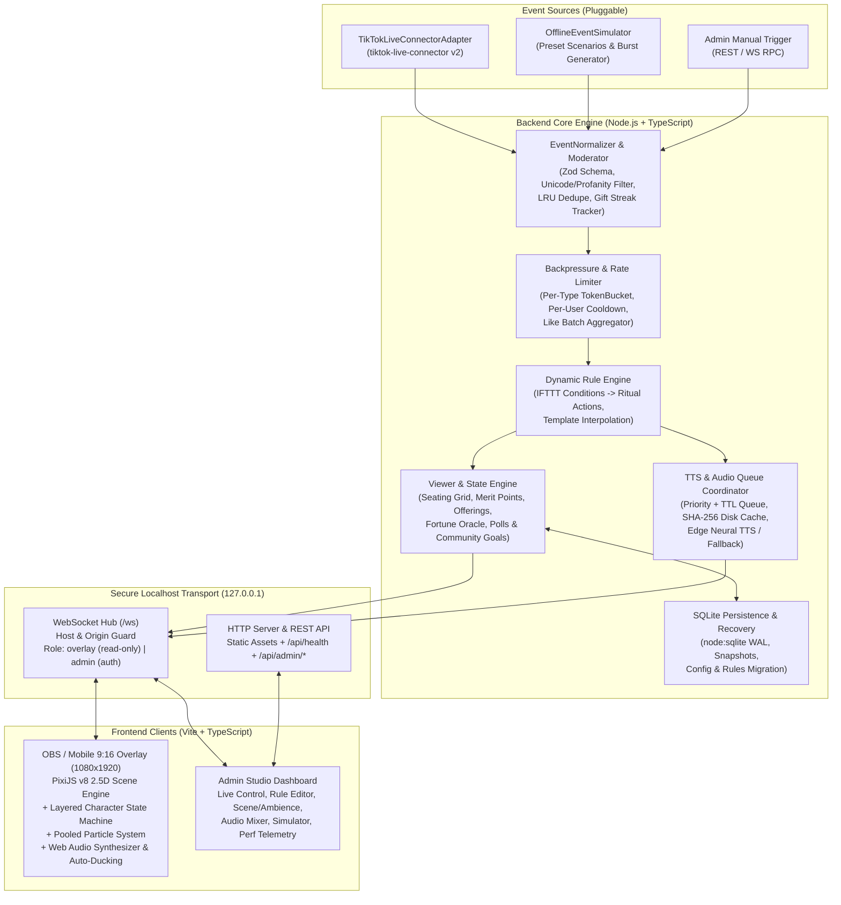

# ARCHITECTURE — TEMPLE LIVE STUDIO

## 1. Tổng Quan Kiến Trúc (Modular Decoupled Architecture)

**Temple Live Studio** được thiết kế theo kiến trúc phân lớp, tách biệt hoàn toàn giữa **Thu thập sự kiện (Connector)**, **Chuẩn hóa & Định tuyến (Normalizer & Router)**, **Trạng thái & Lưu trữ (State & Persistence)**, **Điều khiển & Mô phỏng (Admin & Simulator)** và **Đồ họa & Âm thanh (PixiJS 2.5D Scene Engine & Audio/TTS Engine)**.

---

## 2. Mười Module Độc Lập & Hợp Đồng Giao Tiếp (Typed Contracts)

Toàn bộ các hợp đồng kiểu dữ liệu (interfaces, schemas, message payloads) nằm tại `src/shared/types.ts` và `src/shared/schemas.ts`, giúp thay thế bất kỳ module nào mà không ảnh hưởng các module còn lại:

| # | Module | Đường dẫn chính | Trách nhiệm & Đặc tả kỹ thuật |
|---|---|---|---|
| 1 | **TikTok Connector** | `src/server/connector/tiktokConnector.ts` | Thực thi `ITikTokConnector`. Tải động `tiktok-live-connector`, lắng nghe `CHAT`, `GIFT`, `LIKE`, `MEMBER`, `FOLLOW`, `SHARE`, `ROOM_USER`, `STREAM_END`. Tích hợp **Exponential Backoff + Jitter (±25%)** và **Stale-Socket Watchdog (60s)**. Không bao giờ yêu cầu mật khẩu/cookie/session. |
| 2 | **Event Normalizer & Router** | `src/server/router/eventNormalizer.ts` `src/server/router/eventRouter.ts` `src/server/router/moderation.ts` | Chuẩn hóa payload thô về `NormalizedLiveEvent`. Lọc Unicode rác (Zalgo, Cuneiform), từ ngữ vi phạm, chống trùng lặp bằng `LruDeduplicator` (theo `eventId`), xử lý chuẩn xác **Gift Streak (`giftType === 1`)**, gom nhóm lượt thả tim (`LikeBatchAggregator`) để tránh tạo hiệu ứng riêng cho từng tim khi bão tương tác, kiểm soát tốc độ qua `TokenBucket` và `UserCooldownTracker`. |
| 3 | **Scene Engine (2.5D)** | `src/client/overlay/scene/TempleSceneEngine.ts` `src/client/overlay/scene/ProceduralAtlas.ts` | Quản lý khung cảnh `1080×1920` bằng **PixiJS v8** (tự động fallback sang Canvas 2D renderer đồng nhất nếu môi trường headless/GPU bị giới hạn). Gồm 7 lớp chiều sâu (Background Sanctuary, Wooden Architecture & Pillars, Amitabha Altar & Halo, Offerings & Bronze Censer, Isometric Seating Mat Grid & Red Carpet, Foreground Lanterns & Lotus Pond, Atmospheric Lighting & Weather). Hỗ trợ xử lý mất ngữ cảnh WebGL (`webglcontextlost` / `webglcontextrestored`) và 3 mức chất lượng `LOW / MEDIUM / HIGH`. |
| 4 | **Animation System** | `src/client/overlay/animation/CharacterActor.ts` `src/client/overlay/animation/TimelineScheduler.ts` | Máy trạng thái hữu hạn (FSM) cho nhân vật Phật tử với 7 trạng thái: `APPEAR` → `WALK` → `KNEEL_DOWN` → `SIT_MEDITATE` ⇄ `PRAY_HANDS` ⇄ `PROSTRATE_BOW` → `LEAVE`. Depth sorting chính xác theo trục `y` (`zIndex = Math.round(actor.y)`). Hệ thống `TimelineScheduler` điều phối các đại lễ (Grand Ceremony, Xin Xăm, Thả Đèn Hoa Đăng) không khóa luồng vẽ. |
| 5 | **Audio / TTS Engine** | `src/server/audio/ttsService.ts` `src/client/overlay/audio/TempleAudioEngine.ts` | Phía server: hàng đợi ưu tiên (`PriorityTtsQueue`) có `TTL` (loại bỏ câu chào cũ khi quá hạn), gộp bình luận chờ của cùng 1 người dùng, tạo file giọng đọc tiếng Việt (`msedge-tts` với cache SHA-256 trên đĩa, giới hạn dung lượng thư mục cache). Phía client: Web Audio API synthesizer tạo tiếng Đại Hồng Chung (4 họa âm), Mõ Gỗ (bandpass filter), Chuông Bát Nhã, Lắc Ống Xăm, Nhạc thiền ngũ cung + **Auto-Ducking** khi TTS phát. |
| 6 | **Viewer & State Engine** | `src/server/state/templeStateEngine.ts` | Quản lý danh sách Phật tử đang ngồi thiền trong chánh điện (tự động co giãn lưới bồ đoàn `24 / 36 / 64 / 100`), điểm tích lũy ảo trong ứng dụng (**Điểm Công Đức Ảo** — kèm thông báo rõ ràng phân biệt với quyên góp thực tế), Bảng Vinh Danh (Top tương tác, Top lễ vật, 6 vị trí đệm quỳ VIP), hệ thống **Xin Xăm Văn Hóa** (18 quẻ thơ), **Bình chọn qua Chat (Live Poll)** và **Mục tiêu cộng đồng (Community Goal)**. |
| 7 | **Admin Dashboard** | `src/client/admin/AdminApp.ts` | Giao diện điều khiển trung tâm (cùng ngôn ngữ thiết kế Sơn Mài Vàng Son): Kết nối TikTok LIVE, Bàn điều khiển Nghi thức & Simulator, Trình sửa Luật Event-to-Action (Rule Editor + Import/Export JSON), Chỉnh cảnh & Thời tiết (Day/Night/Dawn, Rain/Mist/Lotus Petals, Quality Presets, Particle Density), Bàn trộn Âm thanh (Sound Mixer), Kiểm duyệt & Nhật ký sự kiện, Biểu đồ hiệu năng thời gian thực (FPS, Frame Time, Queue Depth, Memory). |
| 8 | **OBS Integration** | `src/client/overlay/main.ts` | Hỗ trợ tham số URL chuyên dụng cho OBS Browser Source: `?obs=1` (ẩn nút điều khiển phụ, tự động kích hoạt âm thanh khi OBS cho phép), `?transparent=1` (nền trong suốt hoàn toàn để ghép đè lên video khác), `?hud=minimal|full|none`, `?quality=low|medium|high`, `?fps=30|60`. |
| 9 | **Offline Simulator** | `src/server/simulator/offlineSimulator.ts` | Mô phỏng đầy đủ mọi sự kiện (`chat`, `like`, `gift`, `follow`, `share`, `join`, `viewerCount`, `giftStreak`) mà không cần TikTok đang LIVE. Có các kịch bản sẵn: `serene` (êm dịu), `busy` (đông người xem), `grand_festival` (đại lễ), và `stress_burst` (bắn hàng trăm đến hàng nghìn sự kiện để kiểm thử tải và chống tràn hàng đợi). |
| 10 | **Persistence & Recovery** | `src/server/persistence/sqliteStore.ts` | Sử dụng `node:sqlite` (`DatabaseSync` ở chế độ `WAL` — Write-Ahead Logging, không cần biên dịch native addon C++ trên Windows). Lưu trữ: hồ sơ người xem (`viewers`), lịch sử phiên live (`sessions`), cấu hình hệ thống (`settings`), bộ luật tương tác (`rules`), nhật ký sự kiện (`event_logs`) và bản sao lưu tự động (`backups`). Phục hồi toàn bộ trạng thái ngay khi khởi động lại sau sự cố. |

---

## 3. Luồng Xử Lý Sự Kiện & Chính Sách Backpressure

1. **Ingress & Deduplication**:
   - Mọi sự kiện đi vào đều được gán hoặc trích xuất `eventId`. `LruDeduplicator` (kích thước tối đa `5.000` khóa, TTL `10 phút`) loại bỏ ngay các sự kiện trùng lặp do gói tin WebSocket gửi lại.
2. **Gift Streak Handling (`giftType === 1`)**:
   - Với quà tặng có chuỗi combo (`giftType === 1`), `GiftStreakTracker` theo dõi khóa `(userId, giftId, groupId)`:
     - Khi `repeatEnd === false`: cập nhật bộ đếm tạm thời và chỉ phát tín hiệu hiệu ứng nhẹ trên màn hình (không nhân bản thông báo lớn hay xếp hàng TTS).
     - Khi `repeatEnd === true` (hoặc hết thời gian chờ `4.5s` nếu mất gói `repeatEnd`): chốt tổng số lượng thực tế và kích hoạt nghi thức lễ vật + TTS một lần duy nhất.
3. **Like Flood Aggregation**:
   - Thay vì phát 1 message WebSocket và tạo 1 animation cho mỗi lượt thả tim, `LikeBatchAggregator` gom toàn bộ lượt tim trong cửa sổ `600ms`, giới hạn số nhịp gõ mõ / hạt tim sinh ra trên màn hình tối đa `6 hạt / đợt`, bảo vệ tuyệt đối tốc độ khung hình (FPS).
4. **Bounded Queues & Overflow Policy**:
   - **Ritual Visual Queue**: Giới hạn tối đa `32` nghi thức lớn đang chờ. Khi đầy, nghi thức có `priority` thấp hơn sẽ bị thay thế bởi nghi thức có `priority` cao hơn (`Grand Gift > Gift > Fortune > Prayer > Follow/Share > Chat`).
   - **TTS Queue**: Giới hạn tối đa `20` mục, kèm `TTL` (`join: 25s`, `follow: 60s`, `chat/prayer: 90s`, `gift: 300s`). Nếu cùng một người xem gửi lời nguyện mới khi lời nguyện cũ chưa đọc, lời nguyện mới sẽ cập nhật tại chỗ thay vì xếp thêm hàng.
